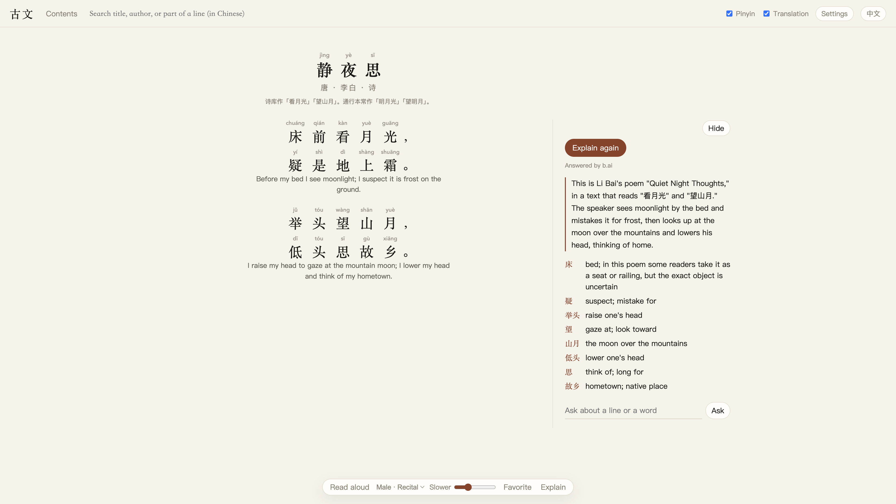

# Guwen · 古文

<p align="center"><b>English</b> · <a href="README.zh-CN.md">中文</a></p>

A local reader for classical Chinese poetry: Tang and Song poems, Song *ci*, and more. Search the corpus, read with pinyin above every character, tap a character to see what it means, or have a male voice read the poem aloud.

The interface comes in Chinese and English; switch with the button in the top-right corner. In English mode, the line-by-line translation, character glosses and answers to your questions are all written in English, so it works as a tool for learning Chinese through its classical poetry. Explanations in each language are cached separately.

With an AI provider configured, each poem you open for the first time gets its characters with several readings (in the title too) checked by the AI. Wrong readings are corrected automatically; readings that are easy to get wrong are listed under the title as "Watch the pronunciation", and clicking one shows why it is read that way. The standard is modern Mandarin (the *Xiandai Hanyu Cidian* and the official table of variant readings), and the AI can only pick from the readings a character actually has. Each poem is checked once, and any reading you correct by hand takes priority.

<p>
  
</p>

## Get the poetry database

Run one command in the project folder:

```bash
./get-poems.command
```

It saves the corpus as `data/poems.db` (about 450 MB).

- This repository already contains a prebuilt database stored with Git LFS. The command downloads it to `data/poems.db`.
- If no prebuilt file is available, the command downloads the source texts from [chinese-poetry](https://github.com/chinese-poetry/chinese-poetry), converts them to simplified Chinese, and builds the same file. This takes a few minutes.

If Git LFS is installed when you clone, `git clone` already brings the database, and the command finishes right away.

The raw JSON lives in `data/chinese-poetry/` only while rebuilding. Read-aloud audio is cached in `data/speech/`. Neither is committed.

Then double-click `start.command`, or run:

```bash
python3 -m venv .venv
.venv/bin/pip install -r requirements.txt
.venv/bin/python server.py
```

Open http://127.0.0.1:8765 in your browser.

## Set up an AI provider

Reading, searching, pinyin and read-aloud all work without one. You only need an AI provider for character glosses, whole-poem explanations and questions.

Put a `.env` file in the project folder (it is never committed). Only providers with a key are used; the rest are skipped. **One provider is enough.** If you configure several, the app moves to the next one when a provider runs out of quota or can't be reached.

Any paid service with an OpenAI-compatible chat API works too. Add these three lines to `.env` and it will be tried first:

```bash
LLM_API_KEY=your-key
LLM_BASE_URL=https://api.example.com/v1
LLM_MODEL=your-model-name
```

`LLM_PROVIDER` is only a display name and is optional.

You can also use just one provider from the built-in list, for example OpenRouter:

```bash
OPENROUTER_API_KEY=your-key
OPENROUTER_MODEL=the-model-you-want
```

If you leave out the model or URL, built-in defaults are used. To point at a different endpoint, set the matching `*_BASE_URL`. Supported key names:

`GROQ_API_KEY`, `NVIDIA_API_KEY`, `OPENROUTER_API_KEY`, `GEMINI_API_KEY`, `CEREBRAS_API_KEY`, `SAMBANOVA_API_KEY`, `BAI_API_KEY`.

The fallback order is set by `LLM_FREE_ORDER` (default `groq,nvidia,openrouter,gemini`). Names not in this list are never used.

## Read aloud

Read-aloud uses Microsoft's Mandarin neural voices. It does not go through the AI providers above and uses none of their keys. The first time you play a poem it needs an internet connection; the audio is then cached in `data/speech/`. Playback speed is adjusted locally.

## Acknowledgements

The texts come from the open-source project [chinese-poetry](https://github.com/chinese-poetry/chinese-poetry), the most complete database of classical Chinese poetry. Thanks to [JackeyGao](https://github.com/jackeygao) and all contributors for turning these poems into usable JSON. This reader only adds simplified-Chinese conversion, search and a reading interface on top of that data; the poems themselves were not written here.

The dataset is released under the MIT License:

> Copyright (c) 2016 JackeyGao
>
> See [chinese-poetry/LICENSE](https://github.com/chinese-poetry/chinese-poetry/blob/master/LICENSE) for the full text.

Currently included: Complete Tang Poems, Complete Song Poems, Complete Song Ci, the Book of Songs (诗经), the Songs of Chu (楚辞), Yuan *qu*, the poems of Cao Cao and Nalan Xingde, poetry of the Five Dynasties, and the selections *300 Tang Poems* and *300 Song Ci*. Other collections such as the Analects, the Four Books and Five Classics, and primers are not imported.
