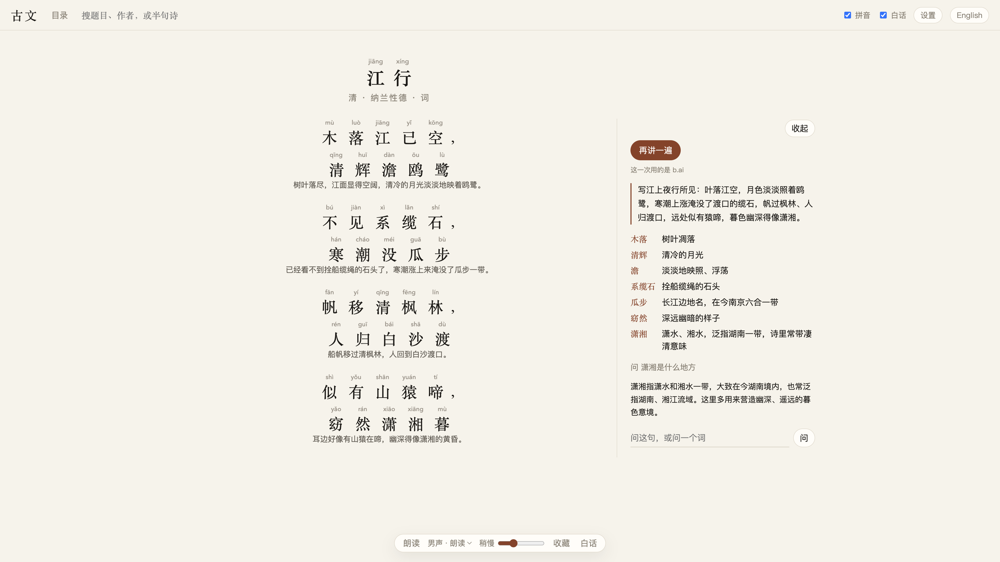
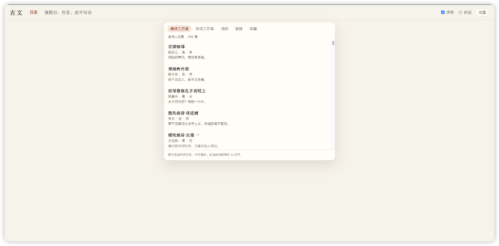

# 古文 · Guwen

<p align="center"><a href="README.md">English</a> · <b>中文</b></p>

在自己电脑上读唐诗、宋诗、宋词和其他古文。可以搜索、看拼音、点一个字看解释，也可以让男声把一首诗读出来。

界面有中文和英文两种，右上角一键切换。切到英文后，整首讲解、点字解释和提问的回答都用英文写，适合用它学中文的外国朋友。两种语言的讲解分开保存，互不覆盖。

配了 AI 之后，每打开一首新诗，会请 AI 把诗里和标题里的多音字核对一遍：读错的自动改正，容易读错的列在标题下面的"注意读音"里，点一下能看到为什么这样读。读音以《现代汉语词典》和《普通话异读词审音表》为准，AI 只能在这个字本来就有的读音里挑。每首只核对一次。你自己改过的读音优先于 AI 的。

<p>
  
</p>

<p>
  
</p>

## 把诗库放进 data

一条命令。在项目目录执行：

```bash
./get-poems.command
```

它把诗库存成 `data/poems.db`，大约 450MB。

- 本仓库里已经有建好的诗库，用 Git LFS 存放。命令会把它下载到 `data/poems.db`。
- 如果这边没有现成文件，命令会从 [chinese-poetry](https://github.com/chinese-poetry/chinese-poetry) 下载原文，转成简体后写入同一个文件。这一步要几分钟。

克隆时如果已经安装 Git LFS，`git clone` 会直接带上诗库，再跑这条命令会发现文件已在，马上结束。

原文 JSON 只在需要重新生成时放在 `data/chinese-poetry/`。朗读声音缓存在 `data/speech/`。这两处都不会提交。

准备好之后，双击 `start.command`，或运行：

```bash
python3 -m venv .venv
.venv/bin/pip install -r requirements.txt
.venv/bin/python server.py
```

浏览器打开 http://127.0.0.1:8765 。

## 配 AI

不配也能读诗、搜诗、看拼音、听朗读。点一个字看解释，以及整首白话，才需要接口。

不必把下面的供应商都填上。`.env` 放在项目目录，不会提交。里面写了密钥的才会用，没写的会跳过。**配其中一个就够。** 配了多家时，一家额度用完或连不上，就自动换下一家。

自己花钱买的也可以，只要它提供兼容 OpenAI 的对话接口。在 `.env` 里写这三行，并优先使用这一家：

```bash
LLM_API_KEY=你的密钥
LLM_BASE_URL=https://api.example.com/v1
LLM_MODEL=你买的模型名
```

`LLM_PROVIDER` 只是显示名称，可以不写。

也可以只用名单里的某一家，例如只买了 OpenRouter：

```bash
OPENROUTER_API_KEY=你的密钥
OPENROUTER_MODEL=你要用的模型
```

模型名和地址不写时，用程序里的默认值。要换成别的地址，再写对应的 `*_BASE_URL`。可选的名字有：

`GROQ_API_KEY`、`NVIDIA_API_KEY`、`OPENROUTER_API_KEY`、`GEMINI_API_KEY`、`CEREBRAS_API_KEY`、`SAMBANOVA_API_KEY`、`BAI_API_KEY`。

换用顺序写在 `LLM_FREE_ORDER`，默认是 `groq,nvidia,openrouter,gemini`。名单里没有的名字不会被用到。

## 朗读

朗读用的是微软的中文神经语音，不走上面的对话接口，也不消耗那些密钥。第一次读一首诗需要联网，声音生成后放在 `data/speech/`。语速在播放时本地调整。

## 致谢

原文来自开源项目 [chinese-poetry](https://github.com/chinese-poetry/chinese-poetry)（最全中文诗歌古典文集数据库）。感谢 [JackeyGao](https://github.com/jackeygao) 和所有贡献者把这些诗整理成可以拿来用的 JSON。这个阅读器只是在那份数据上做了简体转换、检索和阅读；诗句本身不是这里写的。

该数据集以 MIT 许可证发布：

> Copyright (c) 2016 JackeyGao
>
> 许可全文见 [chinese-poetry/LICENSE](https://github.com/chinese-poetry/chinese-poetry/blob/master/LICENSE)。

目前收进本库的有：全唐诗、全宋诗、全宋词、诗经、楚辞、元曲、曹操诗集、纳兰性德、五代诗词，以及唐诗三百首、宋词三百首的篇目。论语、四书五经、蒙学等其他文集没有导入。
